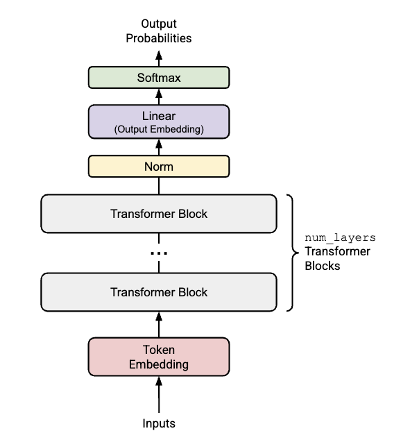
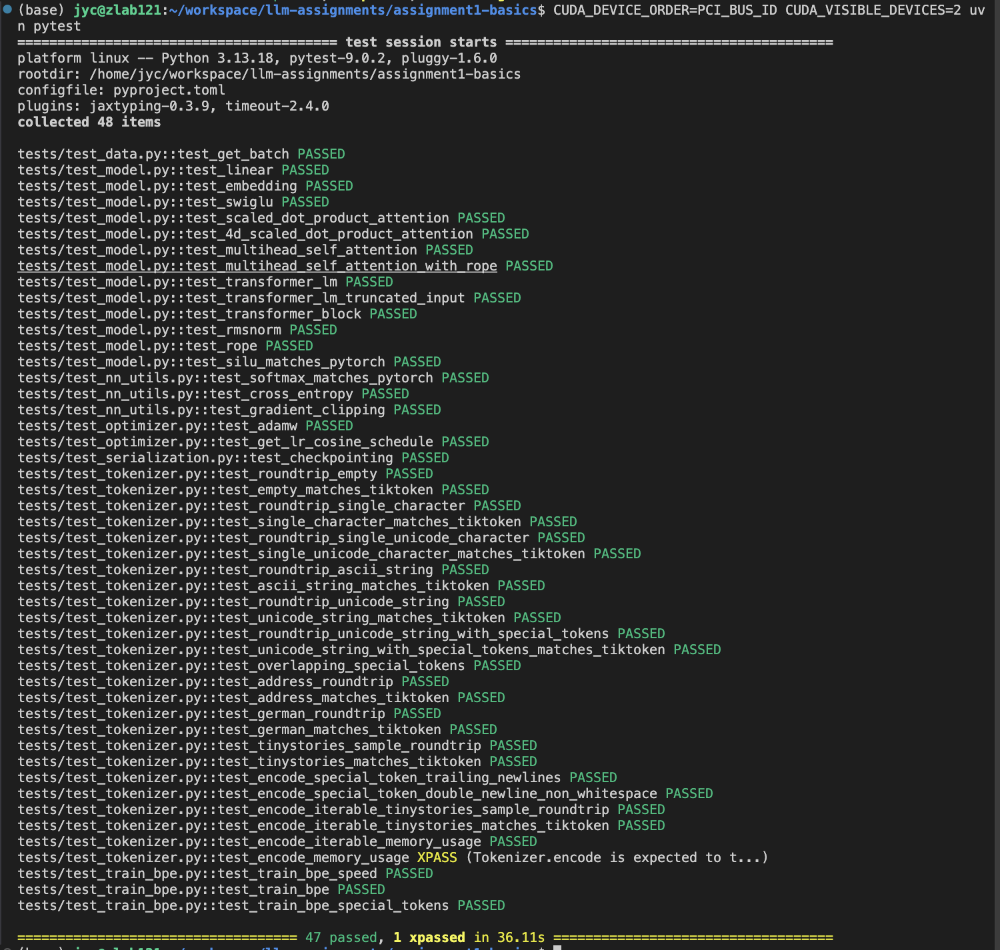
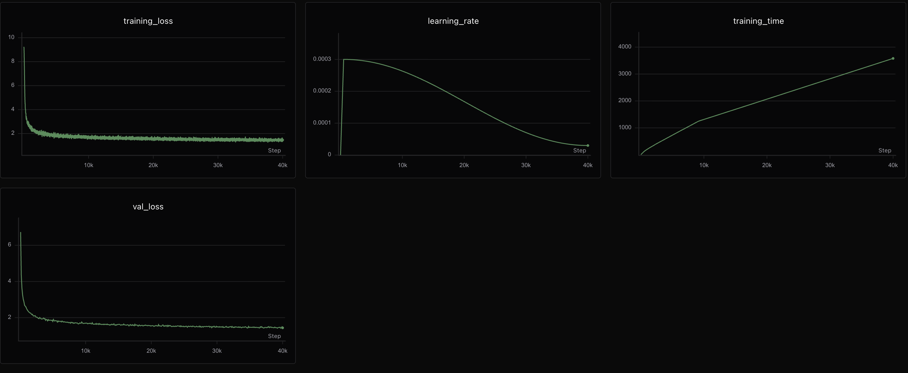
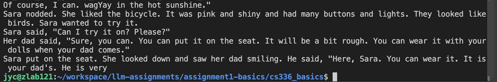

# Assignment 1 Basic

## Part 1 BPE

这一部分帮助我更深刻地理解了 `Byte-Pair Encoding`，由于缺少足够计算资源，我只完成了 pytest 测试需要的部分，并没有做大规模训俩和实验，新增文件为：

```text
cs336_basics/
|---train_bpe.py
|---bpe_tokenizer.py
```

在 `train_bpe.py` 中实现了从某个 corpus 中学习分词规律，构建一个 vocabulary 和  一套 merging rules.
在 `bpe_tokenizer.py` 中实现一个 `Tokenizer` 类，根据训练好的词表和合并规则对 raw text 进行 `encode` 或对 Token IDs `decode` 回 raw text.

### BPE 思想

其他分词方法，比如 Character, Byte, Word level 的 Encoding，要么效率低，要么分词后 token 之间丢失了语义信息。BPE 从 Byte level 出发，通过学习某一个文本资源中的规律，找一种高效的分词方法，从而避免人为硬编码一些不适应的归纳偏置。具体来说，先把文本切分为单个字节，然后根据出现频率，递归地由高到低合并相邻两个 token 加入词表。

### Training

BPE 采用`UTF-8`编码原则，训练可以大致分为三步。

**初始化词表**：词表是一个字典

```python
vocab: dict{int: list[bytes]} 
```

首先把 0-255 单字节值加入到词表，再把 Special Tokens 经过`.encode("utf-8")`处理转化为 `bytes` 后加入词表。所谓的 Special Tokens，指的是在文本中有特殊作用，比如分隔、标记文章末尾等，例如 `<|endoftext|>`.

**Pre-Tokenize**：

我们希望统计相邻两个 token 时，不跨越不同文章和不同单词，于是需要先把整段文本按照 Special Token 划分为不同的文章，在每篇文章内划分出一个个单词片段，将下一阶段的合并限制在同一个单词片段内。在划分过程中，我们可以顺便记录一个字典 pre_token，表示某个 pre token 在文本中出现的次数。

**Merge Up**：

维护一个 token_sequence 字典，记录每个 pre token 当前被分词的情况，初始时每个 pre token 都被切分为单字节序列；
维护一个 token_pair 计数器，记录每个 pair 在文本中出现的次数，每次 merge up 时取出其中出现次数最大的一对进行合并。初始时遍历每个 pre token，记录当前存在的 pair 对和对应的数目；

在当前词表大小到达预期词表大小或者 token pair 已经为空（此时的 vocabulary 已经不需要切分单词了，每个 pre token 都被纳入到了词表）之前，重复下面的操作：
（1）从 token pair 中取出出现次数最多的 token pair 作为 best pair，加入到 vocabulary 和 merges 序列中，同时更新词表大小；
（2）遍历 token_sequence，如果 best pair 出现在某个 pre token 的字节序列中，更新这个 pre token 的字节序列；
（3）根据 pre token 序列的更新情况，更新 token_pair 的计数情况，如果某个 token_pair 数量为零，就把他删去；

### Tokenizer

有了训练好的 vocabulary 和 merge list，我们就可以构建一个 Tokenizer 类对文本信息进行 `encode` 和 `decode`.

**初始化**：

除了 vocab，merges，special token 之外，还需要构建一个 reserve vocab，这在 encode 中用到，此外还要为 merges 构建一个优先级字典，这样在 encode 中才可以按正确顺序合并字节。

**Encode**：

`encode` 与训练 BPE 时类似，首先需要进行 Pre-Tokenize，对每个 pre token 先切分为单字节然后根据 merge list 的优先级合并，最后根据 reverse vocabulary 查找每个 token 对应的 id。与训练时不同，Pre-Tokenize 时不能丢弃 special token，需要将它们也转为 token id，并且 special token 之间可能互为前缀，需要优先匹配最长的 special token。在 merge 时，根据优先级递归地合并直到无法合并。

**Decode**：

`decode` 比较简单，只需要把 ID list 中的元素根据 vocabulary 查表得到的字节值拼接在一起，然后使用 `.decode("utf-8")` 就可以实现。

## Part 2 Transformor Architecture

这一部分从零出发构建 Transformer 的每一个部件：



大多数组件都很基础，这里挑几个我认为手搓一遍收获最大的部件。

（1）**RoPE** 旋转位置编码

存储一个稀疏矩阵非常浪费内存，这里采取存取分块对角矩阵对角元的方式。具体地，存储每个分块矩阵中 `sin` 和 `cos` 值。在前向计算中，切分输入向量 `x` 的奇偶维度分别计算最后再还原。

原理上，这里的位置编码并不是在 `Token Embedding` 时在 embedding 向量上加上位置 embedding，而是在每个 Attention 层中应用在 `Q, K` 矩阵上。

（2）**AdamW** 优化器

Pytorch 在更新参数时候，是根据一个 group 一个 group 来更新的，也就是说可以用这种方式对不同的参数设置不同的学习率。

（3）**梯度裁剪**

和我一直以来的理解不一样，梯度裁剪指的是以整个模型参数的梯度的二范数为参考进行裁剪，并不是对每一个参数的梯度进行单独的缩放。这样做的好处，我认为应该是不改变整个模型梯度的方向，避免参数更新的方向与学到的信息不一致。

完成所有组件后，进行 `pytest`:



## Part 3 Train and Inference

最后完成简单的训练和推理脚本就可以检验模型的实现了，结果如下：





训练脚本中，新知识是使用 `np.memmap` 来加载内存中的大量数据，这个方法把内存中的数据映射成可索引的 `np.ndarray`，便于 `DataLoader` 加载。

推理脚本中，使用了 `top_p` 采样，自回归生成时只在累计分布符合条件的值中按权重采样。
